# Libra

**A production-minded personal life tracker — finance first, then debts, nutrition, sleep, tasks, and an AI assistant grounded in your own data.**

Libra is a mobile-first monorepo: a .NET 10 modular-monolith API with PostgreSQL, and an Expo (React Native) app in TypeScript strict mode. It is built the way a real product is built — one vertical slice at a time, every slice with authorization boundaries, migrations, tests, and a documented decision trail.

<p>
  
  
  
  
  
  
</p>

**Default locale** az-AZ · **timezone** Asia/Baku · **currency** AZN — all three are user settings, never hardcoded in the domain.

---

## Screens

The production UI ("Quiet Premium") after the Phase 2.5B rebuild and its refinement pass. Captures are 390 × 844 from the automated walkthrough in [`docs/screenshots-2.5b-refinement/`](docs/screenshots-2.5b-refinement/README.md).

| Home | Finance dashboard | Add expense | Dark |
|---|---|---|---|
| 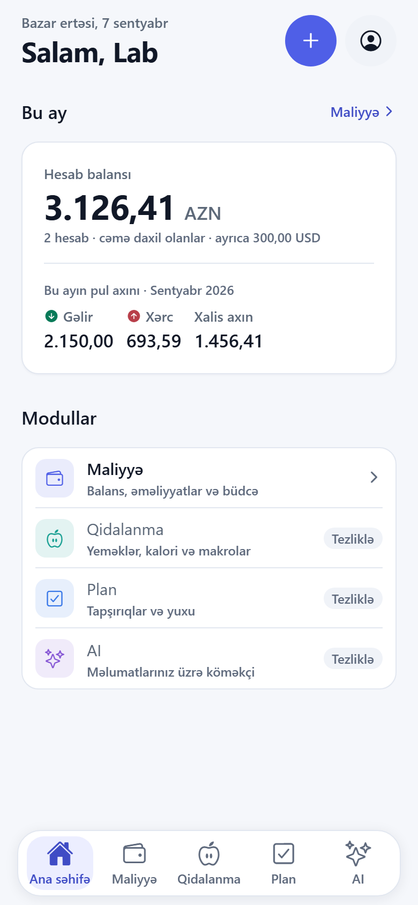 | 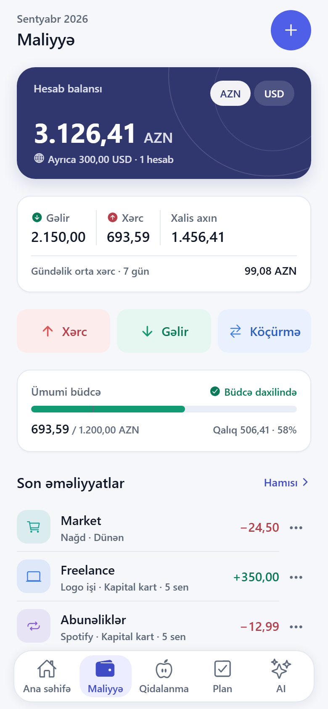 | 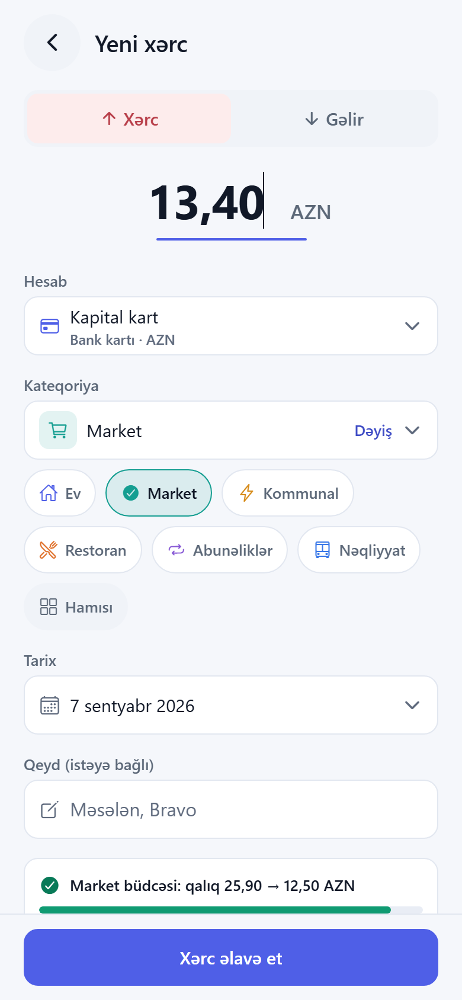 | 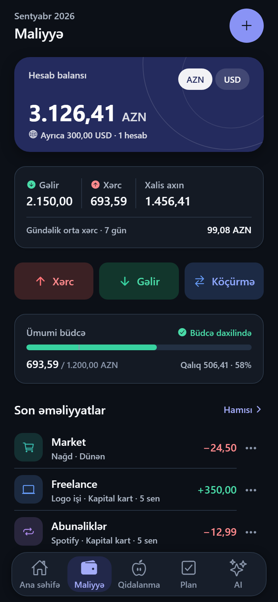 |

| Quick Add sheet | Category search | Transactions | Budgets |
|---|---|---|---|
| 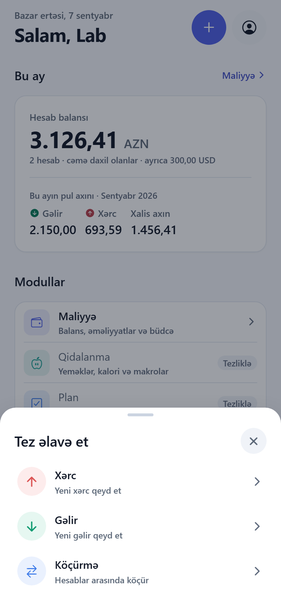 | 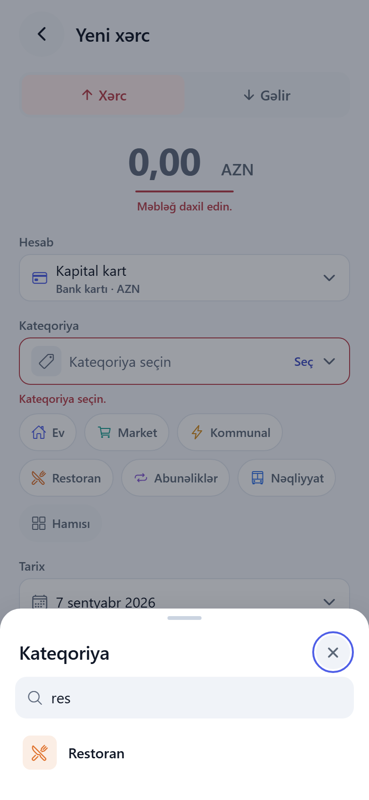 | 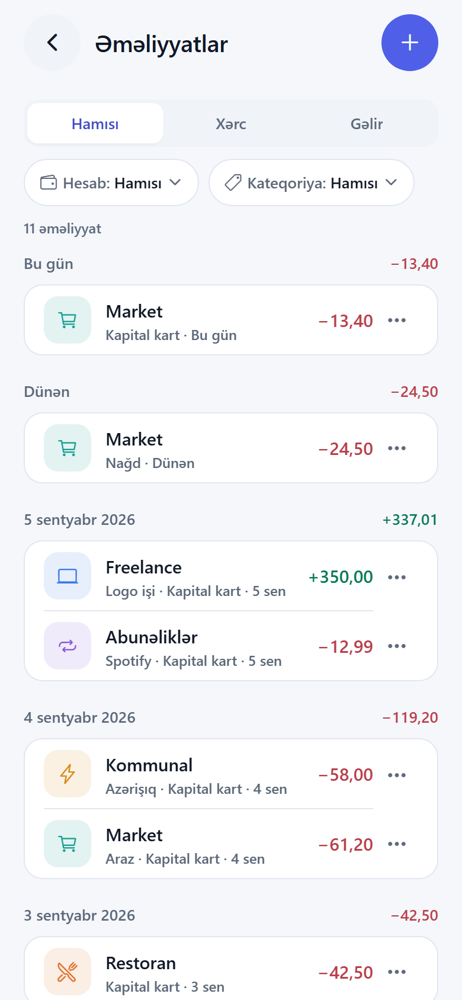 | 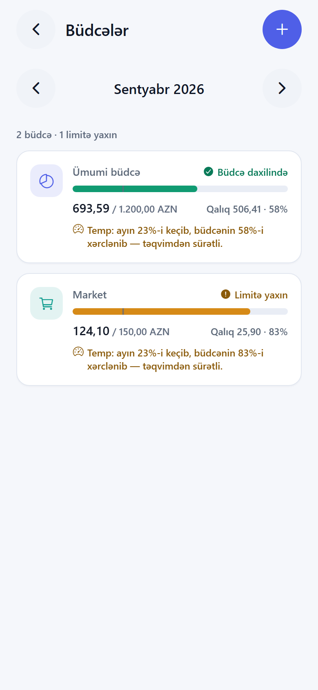 |

| Nutrition diary | Add a meal | Goals | Nutrition (dark) |
|---|---|---|---|
| 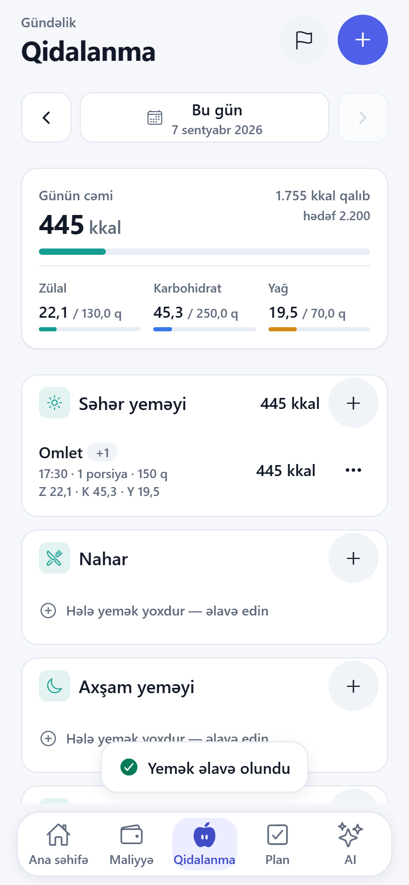 | 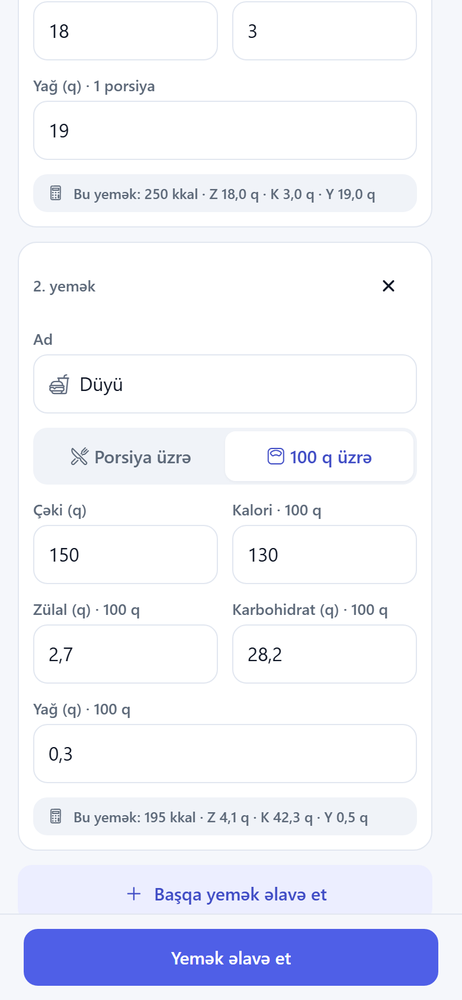 | 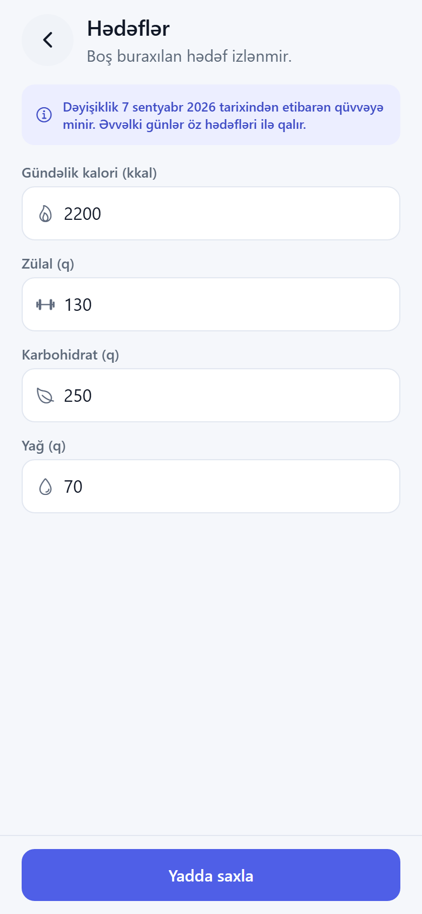 | 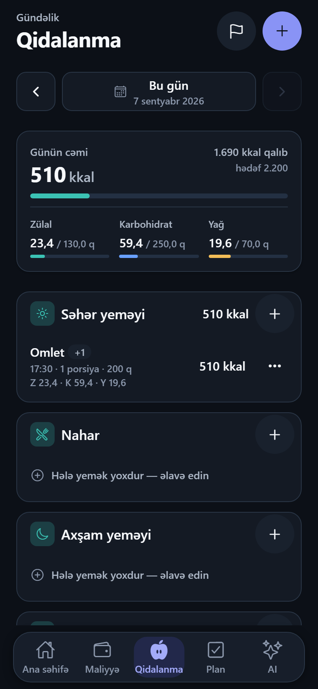 |

Recorded walkthroughs (normal and reduced motion), responsive widths up to desktop, empty/loading/error/stale states, enlarged type and the contrast evidence live in [`docs/screenshots-2.5b-refinement/`](docs/screenshots-2.5b-refinement/README.md) and [`docs/screenshots-3a/`](docs/screenshots-3a/README.md).

---

## What works today

| Area | Status | Notes |
|---|---|---|
| Authentication | ✅ | Register, login, rotating refresh tokens, logout, profile; tokens in SecureStore |
| User isolation | ✅ | Every query and mutation filters on the server-side `UserId`; integration-tested |
| Accounts & categories | ✅ | Multi-currency accounts, income/expense categories, archive semantics |
| Transactions | ✅ | Income, expense and transfers with idempotent creates (`clientRequestId`) |
| Budgets | ✅ | Monthly per-category and overall budgets, usage and pace |
| Dashboard | ✅ | Per-currency balances, month cash flow, daily spend series, insights |
| Nutrition | ✅ | Meals with per-portion / per-100-g foods, daily totals and macros, dated goals, copy into another day |
| Production mobile UI | ✅ | Design tokens, light/dark, reduced motion, accessible contrast, phone → desktop web |
| Photo-based AI food analysis | ✅ | Photo → estimate → editable review → explicit confirmation; the draft never counts until it is confirmed. Needs a provider key; without one the API says so instead of guessing |
| Recurring & debts | ✅ | Monthly plans recorded only by explicit confirmation (one transaction per month, retry-safe); receivables/payables with partial payments, derived remaining/overdue, undo; principal never counted as income or expense |
| Tasks (Plan) | ✅ | Today / upcoming / completed, priorities, overdue kept apart, daily and weekly repetition with independent occurrences |
| Sleep | ✅ | Start / wake with durable server-side sessions, manual entry and corrections, a seven-day summary counted on the wake date, and an optional local reminder on device |
| AI assistant | 🔜 | Phase 7, behind explicit confirmation gates |

Progress and per-phase checklists: [docs/IMPLEMENTATION-PLAN.md](docs/IMPLEMENTATION-PLAN.md).

---

## Architecture

```
┌──────────────────────────────┐        HTTPS / JWT        ┌────────────────────────────────┐
│  Expo app (iOS · Android ·   │  ───────────────────────► │  Libra.Api (ASP.NET Core)      │
│  web)                        │                           │  endpoints · validation ·      │
│  Expo Router · TanStack      │  ◄─────────────────────── │  Problem Details · health      │
│  Query · Zustand · RHF+Zod   │        JSON DTOs          └───────────────┬────────────────┘
└──────────────────────────────┘                                          │
                                                          ┌───────────────▼────────────────┐
                                                          │  Libra.Application             │
                                                          │  one handler per use case      │
                                                          └───────────────┬────────────────┘
                                            ┌─────────────────────────────┴───────────────┐
                                ┌───────────▼───────────┐                     ┌───────────▼───────────┐
                                │  Libra.Domain         │                     │  Libra.Infrastructure │
                                │  entities, invariants │                     │  EF Core · PostgreSQL │
                                │  (no dependencies)    │                     └───────────┬───────────┘
                                └───────────────────────┘                                 │
                                                                              ┌───────────▼───────────┐
                                                                              │   PostgreSQL 18       │
                                                                              └───────────────────────┘
```

Rules that hold everywhere (full text in [CLAUDE.md](CLAUDE.md)):

- **Domain never depends on Infrastructure or Api.** Use cases are organised per module, not in one service folder.
- **Money is `decimal` / `numeric(18,2)`** with ISO 4217 codes — never `float`/`double`.
- **UTC in persistence, `DateTimeOffset` at boundaries**, day/range bucketing through the user's IANA timezone.
- **EF entities never leave an endpoint**; reads project into init-only records.
- **Secrets come from environment variables or user-secrets** and never reach logs.
- **AI can never mutate data** without an explicit preview and user confirmation, and gets application tools rather than database access.

---

## Tech stack

| Layer | Choice |
|---|---|
| API | .NET 10 · ASP.NET Core Web API · Serilog · rate limiting · Problem Details · OpenAPI |
| Data | EF Core · PostgreSQL 18 · deterministic migrations (`dotnet-ef`, repo-local tool) |
| Auth | JWT bearer + rotating refresh tokens; `ClaimsPrincipal.GetUserId()` is the only user-id source |
| Mobile | Expo SDK 57 · React Native 0.86 · React 19 · Expo Router · TypeScript strict |
| Mobile state | TanStack Query (server state) · Zustand (UI state only) · React Hook Form + Zod |
| Mobile UI | Design tokens in `constants/theme.ts` · Reanimated 4 · reduced-motion aware · light/dark |
| Tests | xUnit · Testcontainers (real PostgreSQL) · Jest + React Native Testing Library |
| CI | GitHub Actions ([`.github/workflows/ci.yml`](.github/workflows/ci.yml)) |

---

## Quick start

### Prerequisites

| Tool | Version | Notes |
|---|---|---|
| .NET SDK | 10.0.400+ (10.0.x) | pinned in `global.json` |
| Node.js | 22.13+ (LTS 22 or 24) | Metro declares `^22.13.0` |
| npm | 10+ | ships with Node |
| Docker Desktop / Engine | 27+ with Compose v2 | PostgreSQL and integration tests (Testcontainers) |

### 1. PostgreSQL

```bash
cp .env.example .env && docker compose up -d
```

PostgreSQL listens on `localhost:5440` (`POSTGRES_PORT` in `.env`). Verify with `docker compose ps`.

### 2. API

```bash
dotnet tool restore
dotnet run --project src/backend/Libra.Api
```

On **Windows PowerShell** the same two commands are:

```powershell
dotnet tool restore
dotnet run --project src\backend\Libra.Api
```

To run an already-built API on a fixed URL — useful while a bundler holds the project open — set the environment
variables first and start the assembly from the project directory, so `appsettings.Development.json` is found:

```powershell
$env:ASPNETCORE_ENVIRONMENT = 'Development'; $env:ASPNETCORE_URLS = 'http://localhost:5134'; Set-Location src\backend\Libra.Api; dotnet bin\Release\net10.0\Libra.Api.dll
```

In Development the API applies pending migrations at startup and, when `Jwt:SigningKey` is unset, generates an ephemeral key (logged as a warning). For tokens that survive restarts:

```bash
dotnet user-secrets set "Jwt:SigningKey" "$(openssl rand -base64 48)" --project src/backend/Libra.Api
```

The PowerShell equivalent (no `openssl` needed):

```powershell
dotnet user-secrets set "Jwt:SigningKey" ([Convert]::ToBase64String((1..48 | ForEach-Object { Get-Random -Maximum 256 }))) --project src\backend\Libra.Api
```

#### Reaching the API from a phone

`dotnet run` follows `Properties/launchSettings.json`, whose `applicationUrl` is `http://localhost:5134`. Kestrel
then binds `127.0.0.1` and `[::1]` **only**, so a phone on the same Wi-Fi cannot connect at all — before any
firewall question arises. Bind every interface instead:

```powershell
powershell -ExecutionPolicy Bypass -File .\scripts\start-api-lan.ps1
```

The script picks the adapter that is up, physical and has a default gateway (skipping Hyper-V, WSL, VirtualBox
and link-local addresses), frees port 5134 only if the process holding it is our own API, ensures a stable
`Jwt:SigningKey` in user-secrets, starts the API on `http://0.0.0.0:5134`, checks `/health/ready` on both
loopback and the LAN address, and writes `src/mobile/.env.local` with the address the phone should use. Pass
`-IPAddress 192.168.1.23` when several networks are connected, and `-Detach` to leave it running in the
background.

The equivalent by hand, if you would rather not use the script:

```powershell
$env:ASPNETCORE_ENVIRONMENT = 'Development'; $env:ASPNETCORE_URLS = 'http://0.0.0.0:5134'; dotnet run --project src/backend/Libra.Api --no-launch-profile
```

Then open **`http://<your-lan-ip>:5134/health/ready`** in Safari or Chrome on the phone. That request — not one
made from Windows — is what proves the phone can reach the API.

Photo analysis needs a provider key, which lives only on the backend and never in the mobile bundle:

```bash
dotnet user-secrets set "Ai:OpenAi:ApiKey" "sk-..." --project src/backend/Libra.Api
```

```powershell
dotnet user-secrets set "Ai:OpenAi:ApiKey" "sk-..." --project src\backend\Libra.Api
```

Optional overrides (the defaults are in `appsettings.json`): `Ai:OpenAi:Model` (default `gpt-5.6-luna`),
`Ai:FoodAnalysis:MaxAnalysesPerHour`, `Ai:FoodAnalysis:ImageRetentionMinutes`, `Ai:FoodAnalysis:TimeoutSeconds`.
Confirm what is set with `dotnet user-secrets list --project src\backend\Libra.Api`; the key is never logged.
**Without a key the feature is honest rather than fake**: the upload endpoint answers `503 Service Unavailable`
and the app offers the manual form. For a local demonstration without a provider you may run the fixed sample
estimate, which requires the Development host *and* an explicit opt-in and stamps `development-fixture` on every
draft it produces:

```powershell
$env:ASPNETCORE_ENVIRONMENT = 'Development'; $env:Ai__FoodAnalysis__UseDevelopmentFixture = 'true'; dotnet run --project src\backend\Libra.Api
```

Override the connection string the same way when it differs from the Compose defaults:

```bash
dotnet user-secrets set "ConnectionStrings:Libra" "Host=localhost;Port=5440;Database=libra;Username=libra;Password=libra_dev" --project src/backend/Libra.Api
```

```powershell
dotnet user-secrets set "ConnectionStrings:Libra" "Host=localhost;Port=5440;Database=libra;Username=libra;Password=libra_dev" --project src\backend\Libra.Api
```

Endpoints:

- `GET /health/live` — process is up · `GET /health/ready` — PostgreSQL reachable (503 with details otherwise)
- `GET /openapi/v1.json` — OpenAPI document (Development only)
- `POST /api/auth/register|login|refresh|logout`, `GET|PUT /api/profile`
- `/api/finance/setup|accounts|categories|transactions|transfers|budgets|dashboard`
- `/api/nutrition/day|entries|goals`, `/api/nutrition/food-analysis` (upload, review, confirm, discard)
- `/api/tasks` (today, list, create, edit, completion, delete) and `/api/tasks/series` (edit, stop)

Contracts and conventions: [docs/API.md](docs/API.md). Base URL in development is `http://localhost:5134`.

`dotnet run` applies the `http` launch profile and forces `ASPNETCORE_ENVIRONMENT=Development`; add `--no-launch-profile` to test another environment. To reach the API from a phone, bind wide: `dotnet run --project src/backend/Libra.Api --urls http://0.0.0.0:5134`, or use `scripts/start-api-lan.ps1`, which also reports the address the phone should use.

### 3. Mobile

```bash
cd src/mobile
cp .env.example .env
npm install
npx expo start
```

`EXPO_PUBLIC_API_URL` is the only variable the app reads for the API address (`src/mobile/src/lib/env.ts`); it
defaults to `http://localhost:5134`. `localhost` means *the device itself*, so it is right for the simulator and
for Expo Web and wrong for everything else: use `http://10.0.2.2:5134` on the Android emulator and the computer's
LAN address on a physical phone.

Put the machine-specific address in **`src/mobile/.env.local`**, which git ignores and Expo loads ahead of
`.env`, so it never reaches the repository:

```
EXPO_PUBLIC_API_URL=http://192.168.1.23:5134
```

`scripts/start-api-lan.ps1` (below) writes that file for you. The value is inlined at bundle time, so restart the
bundler with a cleared cache after changing it: `npx expo start -c`.

Expo Web (`npm run web`, port 8081) is allowed by the Development CORS policy; add other origins to
`Cors:AllowedOrigins`. A native app sends no `Origin` header, so CORS plays no part in reaching the API from a
phone. Only `EXPO_PUBLIC_*` variables reach the bundle — never put secrets there.

The app opens on the login screen. After registering, the five-tab shell appears: **Ana səhifə** (month and nutrition summaries, quick add), **Maliyyə** (onboarding on first use, then dashboard, transactions, accounts, transfers, budgets, categories), **Qidalanma** (daily diary, meals, goals, "Şəkildən əlavə et" for a photo estimate you review before it is saved), **Plan** (today's tasks, what is coming, what is done) and one "Tezliklə" placeholder. Sessions restore from SecureStore and access tokens refresh automatically.

### Phone troubleshooting

Work down this list; each step rules out one layer.

| Symptom | Check | Fix |
|---|---|---|
| Health URL times out in the phone's browser | `netstat -ano \| findstr :5134` on Windows | If it shows `127.0.0.1:5134` rather than `0.0.0.0:5134`, the API is bound to loopback. Start it with `scripts/start-api-lan.ps1`. |
| Health URL still times out, and Windows shows `0.0.0.0:5134` | The script's **Windows Firewall** section | It reports whether anything already allows `Libra.Api.exe` inbound on this network. Windows often adds such a rule the first time you accept its prompt — note it matches the *program*, so `dotnet Libra.Api.dll` (which runs as `dotnet.exe`) is not covered. |
| Nothing allows it, and the network is **Public** | `Get-NetConnectionProfile` | Windows refuses inbound connections on Public networks. On your own Wi-Fi, elevated: `Set-NetConnectionProfile -Name '<name>' -NetworkCategory Private`. |
| Still blocked after that | `Get-NetFirewallRule -DisplayName 'Libra dev API (LocalSubnet)'` | Add it once, elevated: `New-NetFirewallRule -DisplayName 'Libra dev API (LocalSubnet)' -Direction Inbound -Action Allow -Protocol TCP -LocalPort 5134 -Profile Private -RemoteAddress LocalSubnet`. Do not disable the firewall and do not widen it to Any/Public. |
| The QR code loads but the API does not | Metro also needs to be reachable | Expo's dev server on 8081 has the same requirements. If Expo Go connects, inbound traffic is getting through for `node.exe`, which says nothing about the API's own rule. |
| Health URL works in Safari, the app still cannot connect | Profile → API address | The bundle inlines `EXPO_PUBLIC_API_URL` at build time. Update `src/mobile/.env.local` and restart with `npx expo start -c`. |
| Phone and computer are on different networks | Router / Wi-Fi name | Guest networks and "client isolation" block device-to-device traffic. Put both on the same normal Wi-Fi, or use a phone hotspot the computer joins. |
| Signed out after every API restart | API log at startup | `Jwt:SigningKey is not configured` means tokens are signed with a throw-away key. `scripts/start-api-lan.ps1` stores a stable one in user-secrets. |
| The LAN address changed | DHCP lease | Re-run the script; it rewrites `.env.local`. A DHCP reservation on the router keeps it stable. |

A request made from Windows only proves Windows can reach the API — Windows does not filter its own traffic.
The phone opening `http://<lan-ip>:5134/health/ready` is the only check that proves the phone can.

### API in Docker (optional)

```bash
docker compose --profile api up --build
```

---

## Verification

Everything CI runs:

```bash
dotnet format Libra.slnx --verify-no-changes
```

```bash
dotnet build Libra.slnx
```

```bash
dotnet test Libra.slnx
```

```bash
cd src/mobile && npm run lint && npm run typecheck && npm test
```

```bash
docker build -f src/backend/Dockerfile -t libra-api .
```

Integration tests spin up a disposable `postgres:18-alpine` through Testcontainers, so Docker must be running. Tests cover authorization boundaries, money and budget calculations, database constraints, recurring idempotency and AI confirmation gates.

---

## Repository layout

```text
Libra/
├── CLAUDE.md                    # engineering rules for humans and AI agents
├── Libra.slnx                   # .NET solution
├── Directory.Build.props        # shared build settings (net10.0, nullable, warnings as errors)
├── Directory.Packages.props     # central NuGet versions
├── docker-compose.yml           # local PostgreSQL (+ optional API profile)
├── docs/                        # product, domain, architecture, API, UX, AI safety, decisions, plan
├── scripts/                     # developer tooling (start-api-lan.ps1: bind the dev API for a phone)
├── src/backend/
│   ├── Libra.Domain/            # entities, value objects, invariants (no dependencies)
│   ├── Libra.Application/       # use cases per module (depends on Domain)
│   ├── Libra.Infrastructure/    # EF Core, PostgreSQL, external adapters
│   ├── Libra.Api/               # ASP.NET Core host, endpoints, health, OpenAPI
│   └── Dockerfile
├── src/mobile/                  # Expo app (routes in src/app, screens/components/hooks/lib alongside)
└── tests/
    ├── Libra.UnitTests/
    └── Libra.IntegrationTests/  # WebApplicationFactory + Testcontainers PostgreSQL
```

---

## Documentation

| Document | What it answers |
|---|---|
| [docs/PRODUCT.md](docs/PRODUCT.md) | What Libra is — and deliberately is not |
| [docs/DOMAIN.md](docs/DOMAIN.md) | Terms, modules, invariants, formulas |
| [docs/ARCHITECTURE.md](docs/ARCHITECTURE.md) | Backend and mobile structure |
| [docs/DATABASE.md](docs/DATABASE.md) | PostgreSQL conventions and migrations |
| [docs/API.md](docs/API.md) | API conventions and contracts |
| [docs/DESIGN-SYSTEM.md](docs/DESIGN-SYSTEM.md) | Tokens, components, contrast table, formatting |
| [docs/MOBILE-UX.md](docs/MOBILE-UX.md) | Navigation, states, accessibility |
| [docs/AI-SAFETY.md](docs/AI-SAFETY.md) | AI boundaries and confirmation gates |
| [docs/DECISIONS.md](docs/DECISIONS.md) | Decision log and open questions |
| [docs/DEVICE-CHECKS.md](docs/DEVICE-CHECKS.md) | Sleep-reminder checks that only a physical phone can prove, and the native configuration behind them |
| [docs/IMPLEMENTATION-PLAN.md](docs/IMPLEMENTATION-PLAN.md) | Phases and checklists |

Visual evidence: [`docs/screenshots-2.5b/`](docs/screenshots-2.5b/) (Phase 2.5B walkthrough), [`docs/screenshots-2.5b-refinement/`](docs/screenshots-2.5b-refinement/README.md) (refinement + correction pass), [`docs/screenshots-3a/`](docs/screenshots-3a/README.md) (nutrition) [`docs/screenshots-3a-a11y/`](docs/screenshots-3a-a11y/README.md) (rendered roles, states and keyboard behaviour of the shared controls) and [`docs/screenshots-appearance/`](docs/screenshots-appearance/README.md) (light / dark / system selection, before and after), each with `results.json`.

---

## Contributing

Read [CLAUDE.md](CLAUDE.md) first — it is the engineering contract for this repository (module boundaries, money and time rules, authorization, testing gates). Work one phase and one vertical slice at a time, keep `docs/IMPLEMENTATION-PLAN.md` in sync, and do not mark anything complete until build, tests, lint and type checks pass.

## License

No license has been chosen yet; all rights reserved by the author until one is added.
